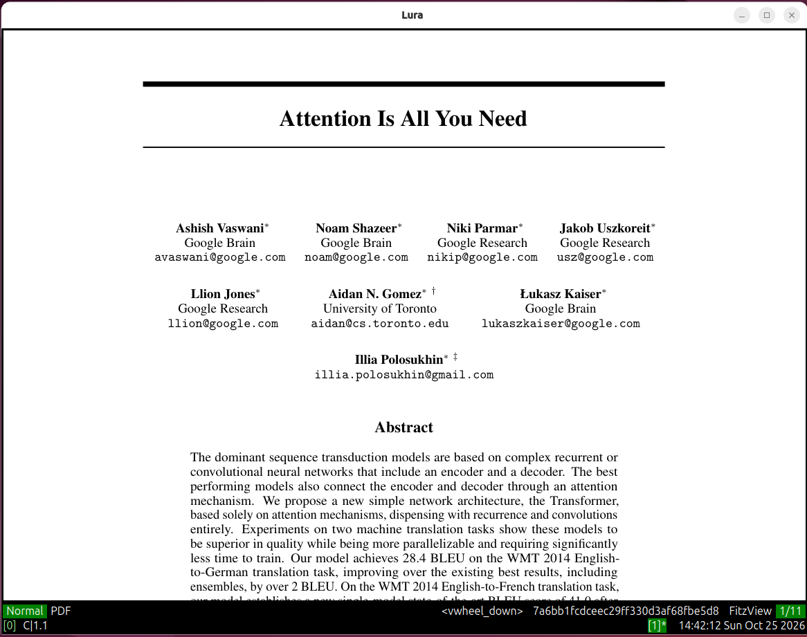
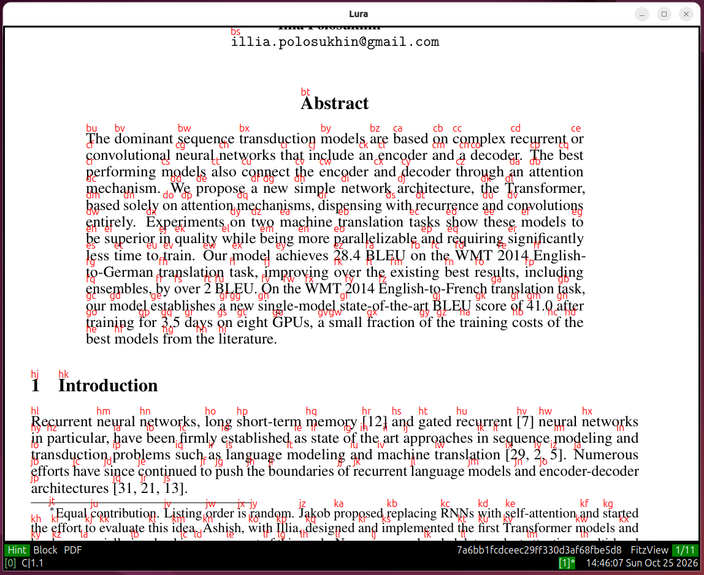
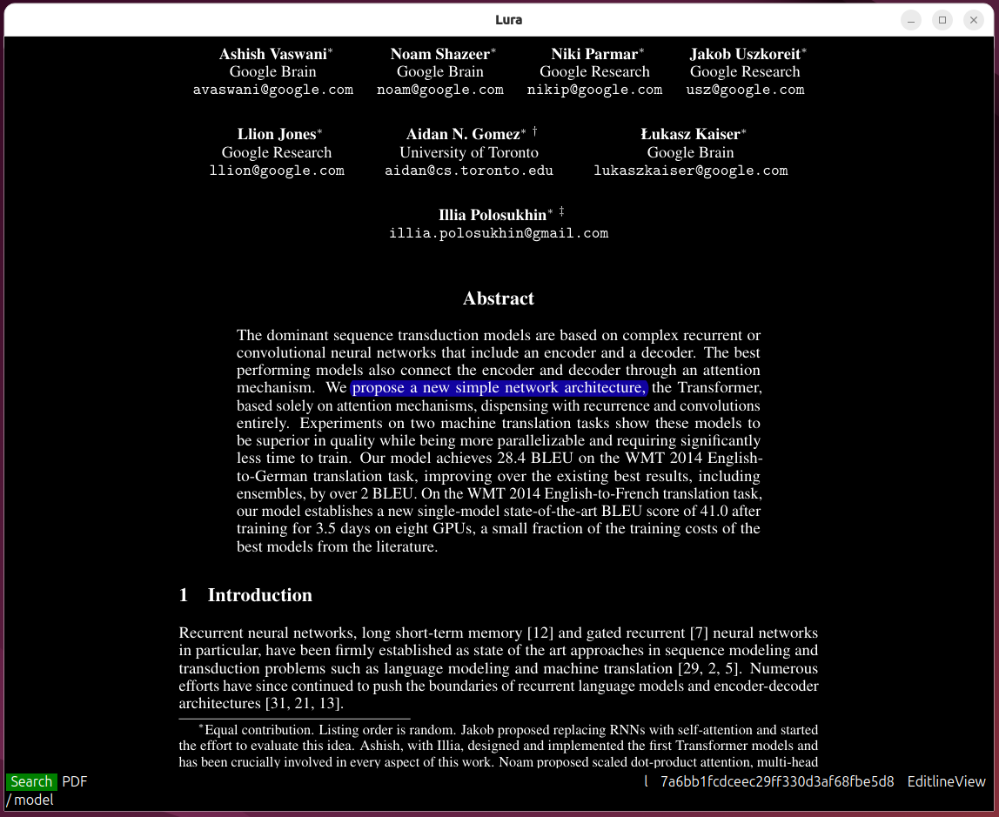
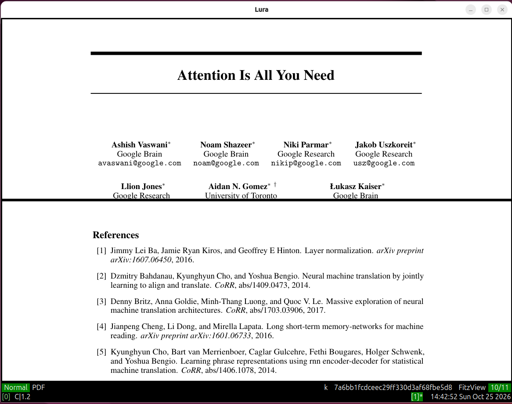
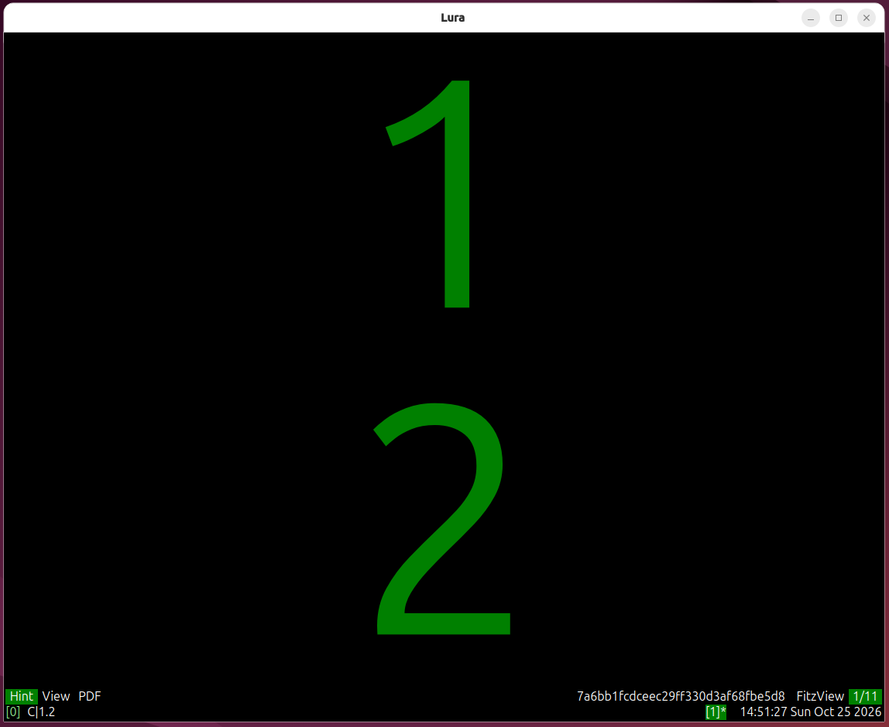
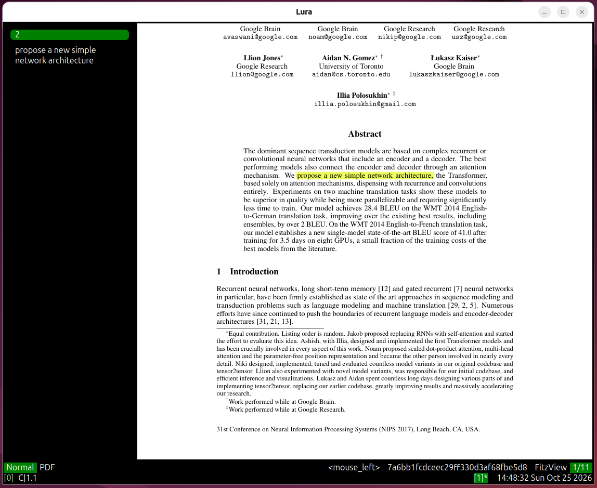

# Lura

Lura is a modal, vim-inspired document viewer written in Python and built on
PyQt6. It is designed around a plugin-based architecture with the goal of
bringing vim-like navigation and editing semantics to a wide range of document
formats. PDF support is implemented today (via PyMuPDF/fitz); the framework is
generic enough to extend to EPUB, Markdown, audio/video and more as demand grows.

## Table of contents

- [Key features](#key-features)
- [Screenshots](#screenshots)
- [Modes](#modes)
- [Keyboard shortcuts](#keyboard-shortcuts)
  - [Notation](#notation)
  - [Normal mode](#normal-mode)
  - [Visual mode](#visual-mode)
  - [Hint mode](#hint-mode)
  - [Annotate mode](#annotate-mode)
  - [Bookmark mode](#bookmark-mode)
  - [Search mode](#search-mode)
  - [Quickmark mode](#quickmark-mode)
  - [Command-line (Exec) mode](#command-line-exec-mode)
  - [Window / tile management (`<C-w>`)](#window--tile-management-cw)
  - [Tab management (`<C-t>`)](#tab-management-ct)
  - [Dock management (`<C-d>`)](#dock-management-cd)
  - [Tree-view keys](#tree-view-keys)
  - [List-view keys (bookmarks / annotations / outline / files)](#list-view-keys)
  - [Global keys](#global-keys)
- [Commands](#commands)
- [Installation](#installation)
- [Configuration](#configuration)
- [Architecture](#architecture)
- [License](#license)

## Key features

**Viewing & rendering**
- PDF rendering via PyMuPDF (fitz)
- Continuous and single-page layouts
- Zoom in / out / to-width / to-height / to-fit, with restore-on-resize
- View rotation (`r`) and per-page rotation (`R`)
- Grayscale toggle for the current view
- Fullscreen presentation modes (tile or dock)

**Window & workspace layout**
- Tiled split windows (horizontal / vertical, with adjustable edges)
- Tabbed views
- Dockable side panels (bookmarks, annotations, outline, files tree)
- Overlay layer and status bar / powerline / tabline / editline widgets

**Navigation**
- Vim-style line and half-screen scrolling (`h j k l`, `H J K L`, `<Space>`)
- Page jumps (`gg`, `G`, `n`, `p`, `[count]G`)
- Jump-list (leaper) for back / forward navigation
- Quickmarks (`m` to set, `` ` `` to jump)
- Outline / table-of-contents tree

**Selection & yank**
- Visual and visual-block selection modes
- Yank selection to clipboard (`yy`, `ys`)

**Hinting (vimium-style labels)**
- Link hints (open URIs in `qutebrowser`)
- Annotation hints (jump to an annotation)
- Word / block hints (enter visual-block selection)
- Box hints (grid with adjustable granularity)
- View / pane hints (switch focus by digit label)

**Annotations**
- Highlight, caret, strikeout, text (sticky note) and underline annotations
- Numbered color categories per annotation type
- Delete annotations
- Dockable annotations panel with SQLite persistence

**Bookmarks**
- Bookmarks with text
- Dockable bookmarks panel with SQLite persistence

**Search**
- Incremental `/` search
- Next / previous / first / last / go-to-N match with `idx/count` powerline info

**Command line & plugin management**
- `:` fuzzy command palette with option tab-completion
- Built-in `quit`, `save`, `open`, `help` commands
- Picky plugin manager (install / update / cleanup git plugins)

**Persistence & state**
- Per-document zoom + scroll state saved to SQLite
- Shared SQLite server on `localhost:19999` with UDP broadcast for multi-instance sync

**Theming**
- CSS-driven colorschemes (ships **Green Elf**)

## Screenshots








## Modes

Lura is modal. Every key binding is scoped to a mode (and optionally a submode,
a view class and a model class), so the same key can mean different things in
different contexts.

| Mode | Submodes | Entry | Exit | Purpose |
|---|---|---|---|---|
| `normal` | – | (default) | – | Default navigation / command mode |
| `visual` | `None`, `block` | `<C-v>` | `<C-v>` / `<C-[>` / `<Esc>` | Region selection; `<C-b>` switches to block submode |
| `hint` | `annotation`, `link`, `block`, `box`, `view` | `<C-f>` | `<C-f>` / `<Esc>` | Label-based jumping; submode via `<C-a>` / `<C-l>` / `<C-w>` / `<C-b>` / `<C-v>` |
| `annotate` | – | `<C-a>` | `<C-a>` / `<Esc>` | Create / delete PDF annotations |
| `bookmark` | – | `b` | `<Esc>` / `<C-[>` | Add a bookmark with text |
| `search` | `jump` | `/` | `<C-[>` / `<Esc>` | Find text and jump between matches |
| `exec` | – | `:` | `<Esc>` / `<C-[>` | Command-line / fuzzy command palette |
| `quickmark` | `mark`, `jump` | `m` (set) / `` ` `` or `''` (jump) | `<Esc>` / `<C-[>` | Set / jump to per-document named marks |
| `any` | – | – | – | Meta-state applying in every mode (e.g. `<C-q>`) |

## Keyboard shortcuts

### Notation

- `<C-x>` = `Ctrl + x` (e.g. `<C-w>` = `Ctrl+w`)
- `<Space>`, `<Esc>` / `<escape>`, `<Enter>` / `<return>`, `<Tab>`
- Arrow keys: `<up>`, `<down>`, `<left>`, `<right>`
- Mouse: `<vwheel_up>` / `<vwheel_down>` (vertical wheel),
  `<hwheel_up>` / `<hwheel_down>` (horizontal wheel),
  `<mouse_left>` / `<mouse_right>` / `<mouse_middle>`
- Uppercase letter = `Shift + letter`
- A count may precede most commands (e.g. `5j`, `3<C-w>zk`, `12G`)
- Three leader prefixes are central to window, tab and dock management:
  - `<C-w>` — tiles / windows
  - `<C-t>` — tabs
  - `<C-d>` — docks

### Normal mode

**Movement & scrolling**

| Key | Action | Description |
|---|---|---|
| `j` / `<down>` / `<vwheel_down>` | `goDown` | Scroll down one line |
| `k` / `<up>` / `<vwheel_up>` | `goUp` | Scroll up one line |
| `h` / `<left>` | `goLeft` | Scroll left |
| `l` / `<right>` | `goRight` | Scroll right |
| `J` / `<Space>` | `goBlockdown` | Half-screen down |
| `K` / `<C-Space>` | `goBlockup` | Half-screen up |
| `H` | `goBlockleft` | Half-screen left *(TreeView: `collapseAll`)* |
| `L` | `goBlockRight` | Half-screen right *(TreeView: `expandAll`)* |
| `n` | `goNext` | Next page |
| `p` | `goPrev` | Previous page |
| `gg` | `goFirst` | First page |
| `G` | `go` | Last page (or `[count]G` = go to page N) |

**Zoom / rotate / view**

| Key | Action | Description |
|---|---|---|
| `zi` | `zoomIn` | Zoom in |
| `zo` | `zoomOut` | Zoom out |
| `zw` | `zoomToWidth` | Zoom to page width |
| `zh` | `zoomToHeight` | Zoom to page height |
| `za` | `zoomToAdjust` | Zoom to fit |
| `r` | `rotateView` | Rotate whole view 90° (countable) |
| `R` | `rotateItem` | Rotate current page 90° (countable) |

**UI toggles & misc**

| Key | Action | Description |
|---|---|---|
| `ts` | `toggleStatusbar` | Toggle status bar |
| `tp` | `toggle` (Powerline) | Toggle powerline |
| `f` | `toggle` (Fullscreen) | Toggle fullscreen of current pane |
| `@` | `activateSubview` | Activate the subview (dock / panel) |
| `yy` | `yankSelection` | Yank current selection to clipboard |
| `ys` | `yankSelection` | Yank selection (alternative) |
| `yp` | `yankPath` | Yank path *(stub)* |
| `<C-[>` / `<Esc>` | `octivate` | Clear selection / return to normal |
| `<C-q>` | `quit` | Quit application (works in any mode) |

**Mode entry (from normal)**

| Key | Action | Description |
|---|---|---|
| `<C-v>` | `activate` (Visual) | Enter Visual mode |
| `<C-f>` | `activate` (Hint) | Enter Hint mode |
| `<C-a>` | `activate` (Annotate) | Enter Annotate mode |
| `b` | `toggle` (Bookmark) | Toggle bookmark edit mode |
| `/` | `activate` (Search) | Start forward search |
| `m` | `setQuickmark` | Set a quickmark (then press a key) |
| `` ` `` / `''` | `goToQuickmark` | Jump to a quickmark (then press a key) |
| `:` | `toggle` (Exec) | Open command line |

**Panel toggles**

| Key | Action | Description |
|---|---|---|
| `<C-B>` | `toggle` (Bookmarks) | Toggle bookmarks panel |
| `<C-A>` | `toggleAnnotations` | Toggle annotations panel |
| `<C-O>` | `toggleOutline` | Toggle outline panel |
| `<C-F>` | `toggle` (FilesTree) | Toggle files-tree panel |

### Visual mode

| Key | Mode | Action | Description |
|---|---|---|---|
| `<C-v>` | normal | `activate` | Enter Visual mode |
| `<C-v>` / `<C-[>` | visual | `octivate` | Exit Visual mode |
| `<Esc>` | visual | `octivate` | Exit Visual mode |
| `<C-b>` | visual | `activate` (BlockVisual) | Enter Visual-block submode |
| `<C-w>` / `<C-[>` | visual[block] | `octivate` | Exit Visual-block |
| `k` / `j` / `h` / `l` | visual[block] | goUp / Down / Left / Right | Move block selection |
| `o` | visual[block] | `goFirst` | Jump to first block |
| `$` | visual[block] | `goLast` | Jump to last block |
| `<C-j>` | visual[block] | `jump` | Jump block |
| `t` | visual[block] | `toggleDirection` | Toggle block direction |
| `<C-a>` | normal / visual | `activate` (Annotate) | Enter Annotate mode |
| `ys` / `yp` | normal / visual | yankSelection / yankPath | Yank selection / path |

### Hint mode

| Key | Mode | Action | Description |
|---|---|---|---|
| `<C-f>` | normal | `activate` | Enter Hint mode |
| `<C-f>` / `<Esc>` | hint | `octivate` | Exit Hint mode |
| `<C-a>` | hint | `activate` (AnnotationHint) | Enter annotation hints |
| `<C-l>` | hint | `activate` (LinkHint) | Enter link hints |
| `<C-w>` | hint | `activate` (BlockHint) | Enter word / block hints |
| `<C-b>` | hint | `toggle` (BoxHint) | Toggle box hints |
| `<C-v>` | hint | `toggle` (ViewHint) | Toggle view (pane) hints |
| `<C-a>` / `<C-[>` / `<Esc>` | hint[annotation] | exit | Exit annotation hints |
| `<C-l>` / `<C-[>` / `<Esc>` | hint[word / link] | exit | Exit link hints |
| `<C-b>` / `<C-[>` / `<Esc>` | hint[block] | exit | Exit block hints |
| `<C-b>` / `<C-[>` | hint[box] | exit | Exit box hints |
| `<C-i>` | hint[box] | `increment` | Increase box granularity |
| `<C-d>` | hint[box] | `decrement` | Decrease box granularity |

In any hint submode, type the displayed letter label(s) to trigger the hint; in
view-hint, type the digit label to switch pane.

### Annotate mode

| Key | Mode | Action | Description |
|---|---|---|---|
| `<C-a>` | normal / visual | `activate` | Enter Annotate mode |
| `<C-h>` | annotate | `addHighlightAnnotation` | Add highlight (then `1`–`6` for color) |
| `<C-c>` | annotate | `addCaretAnnotation` | Add caret (then `1`–`3` for color) |
| `<C-s>` | annotate | `addStrikeoutAnnotation` | Add strikeout (then `1`–`3` for color) |
| `<C-t>` | annotate | `addTextAnnotation` | Add text / sticky note (then `1`–`2`) |
| `<C-u>` | annotate | `addUnderlineAnnotation` | Add underline (then `1`–`2` for color) |
| `d` | annotate | `removeAnnotation` | Delete selected annotation |
| `<C-a>` / `<Esc>` | annotate | `octivate` | Exit Annotate mode |

### Bookmark mode

| Key | Mode | Action | Description |
|---|---|---|---|
| `b` | normal | `toggle` | Toggle bookmark edit mode |
| `<Enter>` / `<return>` | bookmark | `bookmark` | Save bookmark at current position |
| `<Esc>` / `<C-[>` | bookmark | `toggle` (exit) | Exit bookmark mode |

### Search mode

| Key | Mode | Action | Description |
|---|---|---|---|
| `/` | normal | `activate` | Open search editline |
| `/` | search[jump] | `activateEdit` | Re-edit search term |
| `<C-m>` / `<Enter>` | search | `search` | Run search |
| `n` / `j` | search[jump] | `next` | Next match |
| `p` / `k` | search[jump] | `prev` | Previous match |
| `gg` | search[jump] | `first` | First match |
| `G` | search[jump] | `last` / `goTo` | Last match (or `[count]G` = Nth) |
| `<C-[>` / `<Esc>` | search | `octivate` | Exit search |

### Quickmark mode

| Key | Mode | Action | Description |
|---|---|---|---|
| `m` | normal | `setQuickmark` | Enter mark submode (then press `[a-zA-Z0-9]`) |
| `` ` `` / `''` | normal | `goToQuickmark` | Enter jump submode (then press `[a-zA-Z0-9]`) |
| `<Esc>` / `<C-[>` | quickmark | `octivate` | Exit quickmark mode |

### Command-line (Exec) mode

| Key | Mode | Action | Description |
|---|---|---|---|
| `:` | normal | `toggle` | Open command line |
| `<Esc>` / `<C-[>` | exec | `toggle` (exit) | Close command line |
| `<C-l>` / `<Tab>` | exec | `select` | Complete / insert highlighted option |
| `<C-j>` / `<C-n>` | exec | `down` | Next command in list |
| `<C-k>` / `<C-p>` | exec | `up` | Previous command in list |
| `<C-m>` / `<return>` | exec | `act` | Execute typed command |

### Window / tile management (`<C-w>`)

All keys below are prefixed with `<C-w>` (the tile leader).

| Key | Action | Description |
|---|---|---|
| `gg` | `goFirst` | Focus first tile |
| `G` | `goTo` | Focus last tile (or `[count]`) |
| `k` / `j` / `h` / `l` | goUp / Down / Left / Right | Move focus between tiles |
| `s` | `splitHorizontally` | Split tile horizontally |
| `v` | `splitVertically` | Split tile vertically |
| `n` | `goNext` | Next tile |
| `p` | `goPrev` | Previous tile |
| `K` / `J` / `H` / `L` | moveTo Up / Down / Left / Right | Move current tile |
| `x` | `flipTo` | Flip to next (focus) |
| `X` | `flipToWithNoFocus` | Flip to next (no focus) |
| `c` | `closeView` | Close current tile |
| `ze` | `zoomToEqual` | Equalize tile sizes |
| `zk` / `zK` | zoomTop Up / Down | Grow / shrink top edge |
| `zj` / `zJ` | zoomBottom Up / Down | Grow / shrink bottom edge |
| `zl` / `zL` | zoomRight Up / Down | Grow / shrink right edge |
| `zh` / `zH` | zoomLeft Up / Down | Grow / shrink left edge |
| `C` | `toggleGrayScale` | Toggle grayscale |
| `<C-i>` | `next` (Leaper) | Jump list forward |
| `<C-o>` | `prev` (Leaper) | Jump list back |

### Tab management (`<C-t>`)

All keys below are prefixed with `<C-t>` (the tab leader).

| Key | Action | Description |
|---|---|---|
| `gg` | `goFirst` | First tab |
| `G` | `goToLast` | Last tab (or `[count]`); *go-to-last has a known issue* |
| `h` / `p` | `goLeft` | Previous tab |
| `l` / `n` | `goRight` | Next tab |
| `J` / `K` | `moveTo` | Move tab down / up |
| `H` | `moveToLeft` | Move tab left |
| `L` | `moveToRight` | Move tab right |
| `t` | `create` | Create new tab |
| `c` | `close` | Close tab |
| `x` / `X` | `flipTo` | Flip to next tab |

### Dock management (`<C-d>`)

All keys below are prefixed with `<C-d>` (the dock leader).

| Key | Action | Description |
|---|---|---|
| `k` / `j` / `h` / `l` | goUp / Down / Left / Right | Move focus between docks |
| `K` / `J` / `H` / `L` | moveTo Up / Down / Left / Right | Move current dock |
| `x` | `flipTo` | Flip dock (focus) |
| `X` | `flipToWithNoFocus` | Flip dock (no focus) |
| `<C-h>` | `hide` | Hide current dock |
| `<C-H>` | `hideAll` | Hide all docks |
| `zl` / `zL` | zoomRight Up / Down | Grow / shrink dock right |
| `zh` / `zH` | zoomLeft Up / Down | Grow / shrink dock left |
| `zk` / `zK` | zoomTop Up / Down | Grow / shrink dock top |
| `zj` / `zJ` | zoomBottom Up / Down | Grow / shrink dock bottom |

### Tree-view keys

Active in any `TreeView` (FilesView, OutlineView) via `TreeGoToNormal`.

| Key | Action | Description |
|---|---|---|
| `L` | `expandAll` | Expand all nodes |
| `H` | `collapseAll` | Collapse all nodes |
| `pj` | `parentDown` | Move down within parent |
| `pk` | `parentUp` | Move up within parent |
| `rj` | `rootDown` | Move down at root level |
| `rk` | `rootUp` | Move up at root level |
| `sj` | `siblingDown` | Move to next sibling |
| `sk` | `siblingUp` | Move to previous sibling |

### List-view keys

Active in dockable list panels.

| Key | View | Action | Description |
|---|---|---|---|
| `o` | BookmarkView | `open` | Open bookmark (keep focus on list) |
| `O` | BookmarkView | `openAndFocus` | Open bookmark & focus document |
| `d` | BookmarkView | `delete` | Delete bookmark |
| `o` | AnnotationsView | `open` | Go to annotation (select it) |
| `O` | AnnotationsView | `openAndFocus` | Go to annotation & focus document |
| `d` | AnnotationsView | `delete` | Delete annotation |
| `o` | OutlineView | `open` | Go to outline entry |
| `O` | OutlineView | `openAndFocus` | Go to outline entry & focus |
| `o` | FilesView | `open` | Open file / expand dir |
| `O` | FilesView | `openAndFocus` | Open file & focus document |
| `t` | FilesView | `openInTab` | Open file in a new tab |
| `T` | FilesView | `openInTabAndFocus` | Open file in new tab & focus |

### Global keys

| Key | Mode | Action | Description |
|---|---|---|---|
| `<C-q>` | any | `quit` | Quit Lura |

## Commands

The `:` command line auto-discovers every method tagged `(exec)` and exposes
its function name as a command. Typing filters the list; `<Tab>` / `<C-l>`
completes an option; `<C-j>` / `<C-n>` and `<C-k>` / `<C-p>` move the selection;
`<Return>` runs it. Arguments are space-separated and passed positionally.

| Command | Source | Description |
|---|---|---|
| `quit` | `General.quit` | Quit the application (also `<C-q>`) |
| `save` | `General.save` | Save current document (`save [path]`) |
| `open` | `General.open` | Open *(stub)* |
| `help` | `General.help` | Help *(stub)* |
| `PickyInstall` | `Picky.PickyInstall` | Install all plugins listed in `[Picks]` |
| `PickyUpdate` | `Picky.PickyUpdate` | `git pull` every installed picky plugin |
| `PickyCleanup` | `Picky.PickyCleanup` | Remove installed plugins no longer in `[Picks]` |

## Installation

```bash
# Clone the repository
git clone https://github.com/aotabekov91/lura
# Move into the project directory
cd lura
# Create and activate a virtual environment
python3 -m venv .venv
source .venv/bin/activate
# Install and run the project
pip3 install -e .
```

After installation, launch Lura with

```bash
lura path/to/document.pdf
```

## Configuration

Lura reads its configuration from `src/lura/config.toml` (overridable per-user under the configured settings folder, which defaults to `~/.config/lura`).

### Notable defaults:

```toml
[Plugman.Settings] 
folder = '~/.config/lura'

[View]             
zoomFactor = 0.1
scaleFactor = 1.0
continuousMode = true 
layoutMode = 'SinglePage'

[View.Item]        
xresol = 72 
yresol = 72 
rotation = 0

[View.Layout]      
pageSpacing = 0

[FitzView]         
convertToGrayScale = false

[FitzView.Layout]  
pageSpacing = 5 
padding = [0, 0, 0, 0]
```

Annotation color/category mappings live in `src/plug_qt/plugs/annotate/config.toml`; Picky picks are declared via a `[Picks]` array in the app config. Colorschemes are CSS files dropped under `src/plug_qt/plugs/colorschemes/<name>/colorscheme.css` (ships `green_elf`).

## Architecture

Lura is split across three source roots:

| Root | Role |
| :--- | :--- |
| `src/plug/` | Framework core: the Plug base, tag / deleg decorators, the Earman key listener, Delegman, Stateman, Buffman, Plugman, Styleman, and the parser of key(mode[submode])[view]{model} tags |
| `src/plug_qt/` | PyQt6 implementation: App, View, Earman, Buffman, Plugman, Stateman, Styleman, the gizmo widget kit (WindowView, TabView, TileView, DockView/Docks, TreeView, ElementListView, StatusBarView, OverlayView) and the reusable plugs/ library |
| `src/lura/` | The application: Lura(App), config.toml, style.css, and plugs/ (fitz / PDF backends) |

### How key bindings work
Each method is decorated with `@tag("KEY(mode[submode])[ViewClass]{ModelClass}")`. The parser splits the tag into key / mode / submode / view / model (any of which can be any). 

* `/` separates key alternatives.
* `{x}/{y}` is a multi-key literal group.
* A tag with no key `((exec))` is a command-line command.
* A plugin may set `prefix_keys=["<c-x>(mode)"]`, in which case every tagged key of that plugin is prefixed with that leader — so `prefix_keys=["<c-w>(normal)"]` plus `@tag("v(normal)")` produces the effective binding `<C-w>v`. Prefixing is skipped only for keys starting with `~`. 
* `@deleg("action@(mode)[view]{model}")` exposes a delegation hook that fitz backends fill in.

### Loaded PDF backends 
Located in `src/lura/plugs/__init__.py::get_base_plugs()`:
* PdfFitz
* FitzNormalGoTo
* FitzCopy
* FitzAnnotate
* FitzAnnotationEdit
* FitzFullscreen
* FitzGrayscale
* FitzAnnotationHint
* FitzLinkHint
* FitzBoxHint
* FitzBlockHint
* FitzOutline
* FitzRotate
* FitzSearch
* FitzSelection
* FitzBlockVisual
* FitzYankSelection
* FitzZoom

## License

See `LICENSE` for details.

